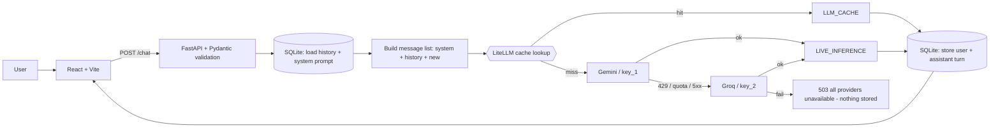

# Resilient AI

**Reliable LLM Conversations. Built for Failure.**

A multi-turn LLM chatbot (React + FastAPI + LiteLLM + SQLite) with automatic key failover (Gemini → Groq), LiteLLM response caching, per-request token/latency metadata and an on-demand failure simulator.

## 1. Live URLs

- Frontend: _<add your Vercel URL>_
- Backend: _<add your Render/Railway URL>_ (health: `<backend>/health`)

## 2. Run locally: with Docker and without

### With Docker
```bash
cp .env.example .env     # then put GEMINI_API_KEY / GROQ_API_KEY in .env (make up also creates it if missing)
make up                  # frontend http://localhost:3000, backend http://localhost:8000
make down                # stop (the named volume `app_data` keeps your SQLite history)
```

### Without Docker
```bash
# backend (Python 3.12)
cd backend
python -m venv .venv && source .venv/bin/activate
pip install -r requirements-dev.txt
export GEMINI_API_KEY=... GROQ_API_KEY=...            # or LLM_API_KEYS=gemini_key,groq_key
export DATABASE_URL=sqlite:///./app.db ALLOWED_ORIGINS=http://localhost:3000 ENABLE_FAILURE_SIMULATION=true
uvicorn app.main:app --port 8000
python -m pytest -q                                   # tests (no real API calls)

# frontend (Node 20+)
cd frontend && npm install
VITE_API_BASE_URL=http://localhost:8000 npm run dev   # http://localhost:3000
```

### Environment variables
| Variable | Meaning |
|---|---|
| `LLM_API_KEYS` | Assignment key pool, comma-separated. 1st = `key_1` (Gemini), 2nd = `key_2` (Groq) |
| `GEMINI_API_KEY`, `GROQ_API_KEY` | Provider-specific keys; override their slot in `LLM_API_KEYS` |
| `GEMINI_MODEL`, `GROQ_MODEL` | LiteLLM model names (defaults: `gemini/gemini-2.5-flash`, `groq/llama-3.3-70b-versatile`) — verify they are current |
| `DATABASE_URL` | `sqlite:////data/app.db` (Docker volume) or `sqlite:///./app.db` |
| `ALLOWED_ORIGINS` | Comma-separated CORS origins |
| `ENABLE_FAILURE_SIMULATION` | `true` enables the `X-Simulate-Failure` hook |
| `VITE_API_BASE_URL` | Frontend → backend URL (build-time) |

## 3. Design decisions: key fallback, caching, SQLite session storage



- **Key fallback.** The key pool is ordered: `key_1` = Gemini (primary), `key_2` = Groq (fallback). `llm_service.complete()` calls `litellm.completion(...)` for each key in order. Any provider error (429, quota, 5xx, connection, auth) moves to the next key; `fallback_attempts` counts failures before success. If all fail → `503 {"detail":"all providers unavailable"}`. Real keys never leave the process; clients only see `key_1`/`key_2`.
- **Failure simulation.** `X-Simulate-Failure` (e.g. `key_1=429`, `*=429`) is parsed per request and honoured only if `ENABLE_FAILURE_SIMULATION=true`. A simulated key is skipped as a failed attempt; the next key makes a *real* LiteLLM call.
- **Caching.** LiteLLM's built-in in-memory cache (`litellm.cache = Cache(type="local")`) with `caching=True` on every call. The cache key is derived by LiteLLM from the model + full message list (system prompt + history + new message), so a different prompt, system prompt or history never hits. A hit is detected from LiteLLM's `cache_hit` flag and reported as `LLM_CACHE` with the stored usage, `key_id: null`, `fallback_attempts: 0`. Because the model is part of the key, a Gemini answer is never labelled as Groq. The cache is per process (single uvicorn worker) and is cleared on restart; history is not.
- **Multi-turn.** The client sends only `session_id`, `message` (and optional `system_prompt`). The backend loads history from SQLite, builds the LLM messages and, **only after a successful answer**, writes the user + assistant rows in one transaction. 422/503 requests leave no trace. A session's `system_prompt` is stored (in a small `sessions` table) so later turns reuse it; it is never returned as a history message.
- **SQLite.** `messages` table exactly as specified (+ index on `session_id`) auto-created at startup; assistant `metadata` is JSON text; timestamps are server-side ISO-8601 UTC. In Docker the file is `/data/app.db` on the named volume `app_data`.
- **Errors.** Every error is JSON (`422` FastAPI shape, `404`/`503` per contract, `500 {"detail":"internal server error"}` for anything unexpected). Provider exception text is logged by type only, never returned.
- **Tokens/latency.** `input_tokens`/`output_tokens` come from the provider usage of *that* request; `latency_ms` is measured server-side with `perf_counter` (integer ms).

## 4. Verification: how to see failover, cache hits and per-message token usage

```bash
B=http://localhost:8000
# health
curl -s $B/health
# normal chat (key_1, LIVE_INFERENCE)
curl -s -X POST $B/chat -H 'Content-Type: application/json' -d '{"session_id":"s-demo1","message":"What is Docker?"}'
# cache hit: same prompt in a NEW session -> LLM_CACHE, key_id null, same reply and tokens
curl -s -X POST $B/chat -H 'Content-Type: application/json' -d '{"session_id":"s-demo2","message":"What is Docker?"}'
# Gemini simulated 429 -> real Groq answer (key_2, fallback_attempts 1)
curl -s -X POST $B/chat -H 'Content-Type: application/json' -H 'X-Simulate-Failure: key_1=429' -d '{"session_id":"s-demo3","message":"Name a prime number"}'
# Gemini simulated 500 -> Groq
curl -s -X POST $B/chat -H 'Content-Type: application/json' -H 'X-Simulate-Failure: key_1=500' -d '{"session_id":"s-demo4","message":"Name a color"}'
# all providers 429 -> 503 {"detail":"all providers unavailable"}, nothing stored
curl -s -i -X POST $B/chat -H 'Content-Type: application/json' -H 'X-Simulate-Failure: *=429' -d '{"session_id":"s-demo5","message":"hello"}'
curl -s -i $B/sessions/s-demo5/messages          # 404 {"detail":"session not found"}
# history (oldest first, with per-message token usage in assistant metadata)
curl -s $B/sessions/s-demo1/messages
```
In the UI every assistant reply shows source, model, latency and per-request input/output tokens; the **Resilience Lab** sends the same header for you.

Backend tests: `cd backend && python -m pytest -q` (provider network calls are mocked through LiteLLM's `mock_response`, so no quota is used).

## 5. Setup Used: your editor and AI tools

_Fill in honestly (editor, AI assistants, anything else you used)._

## 6. Bonus features (if any): what you added beyond the requirements and why

- **System Health panel** — reads the real `GET /health` (backend, SQLite, key count, cache).
- **Resilience Lab** — one-click `X-Simulate-Failure` modes (the contract header, no extra endpoint) plus a visual failover path built from the real response (`failed_keys` metadata).
- **Session History Inspector** — renders `GET /sessions/{id}/messages` straight from SQLite to demonstrate persistence.
- **System prompt** — editable, part of the LLM context and cache identity, not stored as a chat message.
- **Metadata UX** — compact chips + details; cache hits show the real measured speed-up versus the earlier live call for the same prompt on this page.
- **Error handling** — readable messages, Retry on failed sends, JSON-only errors from the backend.

## Deployment

**Backend (Render, `render.yaml` included):** create a Web Service from the repo (Docker, `backend/`). Attach a **persistent disk mounted at `/data`** (Render requires a paid instance type for disks; without a disk SQLite is wiped on every deploy) and set `DATABASE_URL=sqlite:////data/app.db`, `GEMINI_API_KEY`, `GROQ_API_KEY`, `ENABLE_FAILURE_SIMULATION=true`, `ALLOWED_ORIGINS=<your Vercel URL>`. On Railway: add a Volume mounted at `/data` and the same variables.

**Frontend (Vercel):** import the repo, root directory `frontend`, framework Vite, set `VITE_API_BASE_URL=<backend URL>`, deploy. Then put the Vercel URL in the backend's `ALLOWED_ORIGINS` (comma-separate multiple origins) and redeploy the backend.
